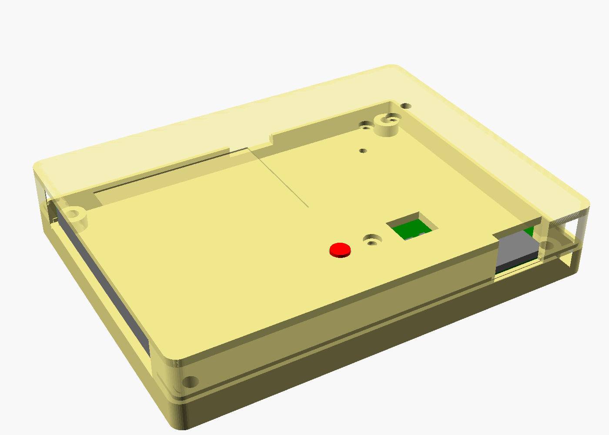

# FujiNet-TRS80M1 Rev0 case: dimension dossier

`FujiNet-TRS80M1-Case.scad` is a two-piece case (a tray and a lid) for the 100 x 76 mm board.
`board-anchors.scad` is generated by `tools/gen_pcb.py` from `tools/placement.py` and `tools/header_geom.py`.
The openings, bosses and plunger therefore follow the board.

The case stands beside the Model I's keyboard unit, where the Expansion Interface would.
- A 40-wire ribbon brings the expansion edge to the box header's mouth in the west wall.
- The USB-C (the card's only power) is in the north wall, the microSD in the south wall.

**Nothing was measured for this case:** no Model I, no cable, no printed case.
- **The board numbers are the board's own:** the outline, the holes, every courtyard and part height.
- **VERIFY marks every number that stands in for a measurement nobody has made.** Print one case and fit it before printing more.



## The case

| | |
|---|---|
| Outside | 105.2 x 81.2 x 18.7 mm (W x D x H): the board plus 0.6 mm and a 2.0 mm wall on every side |
| Board | B.Cu 5.5 mm above the tray's outside, F.Cu at 7.1 mm (the parting plane), 9.6 mm under the lid's inner face.<br>The tallest part is the box header's shroud, 8.85-9.0 mm (`header_geom.HDR_H` 8.9; VERIFY on the delivered part). |
| Tray | The 2.0 mm floor and the walls up to F.Cu.<br>Four 7 mm bosses under the board's M3 holes, the board resting on them.<br>The inner half of the wall rises 1 mm into a rebate in the lid (alignment). |
| Lid | The 2.0 mm top and the walls from F.Cu up. It has:<br>• RESET through a 4.8 mm hole, with a printed plunger (FujiNet-O2 / ColecoVision Rev0's).<br>• BOOTSEL, S3 BOOT and S3 EN as 2.2 mm pin-holes in guide tubes. Each sits in a 1.2 mm counterbore, so none is pressed by accident.<br>• A 9.0 x 7.6 mm window over the DIP switches: a pen tip flips each slide.<br>• Shrouded windows for the WS2812 (3.0 mm) and the RP's red LED (2.0 mm).<br>• A 40 x 30 mm label recess, 0.4 mm deep, over the bus buffers.<br>• Four bosses that press the board down onto the tray's. |
| West wall | A 61.0 x 9.8 mm opening, centred on the header.<br>It clears the shroud (58.6 x 8.9 mm, its mouth 0.24 mm past the board edge), and the ribbon's 2x20 IDC socket plugs straight in.<br>VERIFY: a socket with a strain-relief bar needs ~1 mm more height. |
| North wall | USB-C opening, 13 x 7.2 mm, sized for a plug's overmold. It spans both halves. |
| South wall | microSD slot, 14 x 2.4 mm, on the card's centreline. In the lid the slot is open up to the top, so a thumb reaches the latched card. |
| East wall | Plastic only beside the ESP32-S3's antenna (the module's antenna end is flush with the board's east edge). The M3 screws are at the corners, 23 mm or more from the module's antenna. |
| Fasteners | 4x M3x16 pan head from under the tray, through its bosses and the board's 3.2 mm holes, into the lid's bosses.<br>The lid's bosses have 2.5 mm self-tap pilots; set `insert_d = 4.0` for M3 heat-set inserts. |
| Under the board | 3.5 mm clear, for the leads of the THT box header (and the logic-analyser header, if fitted). VERIFY: lead length after soldering. |

Export:

```
openscad -D 'part="lid"'     -o lid.stl     case/FujiNet-TRS80M1-Case.scad
openscad -D 'part="tray"'    -o tray.stl    case/FujiNet-TRS80M1-Case.scad
openscad -D 'part="plunger"' -o plunger.stl case/FujiNet-TRS80M1-Case.scad
openscad -D 'part="both"'    -o both.stl    case/FujiNet-TRS80M1-Case.scad   # all three (FujiNet-TRS80M1-Case.stl)
openscad -D 'part="check"'         -o check.stl case/FujiNet-TRS80M1-Case.scad   # must report an empty object
openscad -D 'part="parts_check"'   -o pc.stl    case/FujiNet-TRS80M1-Case.scad   # must report an empty object
openscad -D 'part="parts_control"' -o ctl.stl   case/FujiNet-TRS80M1-Case.scad   # must NOT be empty
```

`part="assembled"` and `part="section"` (cut across the header and the RP) are for viewing.

**Printing:**
- Each half prints outside-down, with no supports, at 0.2 mm layers, in PETG or PLA. The plunger prints cap-down.
- The lid is turned over for printing by a rotation, never a `mirror()`: a mirror would export the lid's mirror
  image, which does not fit the board.
- No carbon-fibre or metal-filled filament: the ESP32-S3's antenna is behind the east wall.

**Assembly:**
1. Drop the plunger, cap first, into the lid's RESET guide.
2. Lay the board in the tray, B.Cu down, on the four bosses.
3. Close the lid.
4. Fit the four screws from below.
5. With the Model I off, plug the ribbon into the header through the west wall: its stripe to the PIN 1 arrow,
   the south end.

**The SCAD asserts:**
- the tallest part clears the lid;
- the leads have room under the board;
- no lid hole lands in the label;
- no screw is within 15 mm of the antenna;
- the west opening clears the header's shroud;
- the RESET guide clears the BOOTSEL tube.

**Checked 2026-11-24 (OpenSCAD 2021.01):**
- `check` and `parts_check` are empty: the board, the plunger and every fitted part's courtyard (to its height)
  clear both halves.
- `parts_control` (the same boxes raised to the lid) is not empty, so the check is live.
